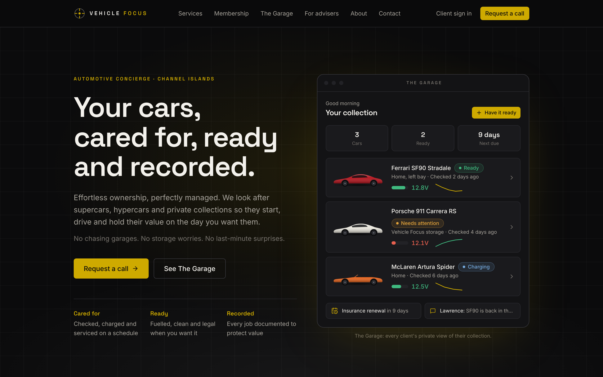
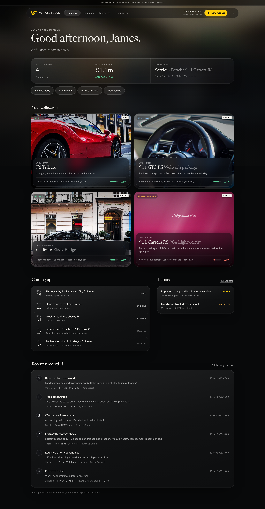
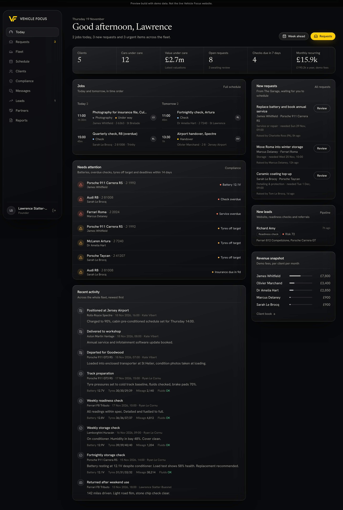

# Vehicle Focus

A new website and a bespoke client platform for Vehicle Focus, the automotive concierge for supercar and hypercar owners in the Channel Islands, UK and Europe.

One Next.js codebase, three faces:

| Area | Path | Who it's for |
| --- | --- | --- |
| Public website | `/`, `/services`, `/membership`, `/the-garage`, `/readiness`, `/advisers`, `/about`, `/contact` | Prospective clients and the advisers who refer them |
| **The Garage** (client portal) | `/garage` | Clients and their delegates (PAs, partners, family offices) |
| **Console** (operator system) | `/console` | Lawrence and the Vehicle Focus team |

The thinking behind it is in `docs/`:

- [`docs/01-website-review-and-ideas.md`](docs/01-website-review-and-ideas.md): review of the current site and what the new one should do
- [`docs/02-platform-spec.md`](docs/02-platform-spec.md): VehicleVault teardown, what we borrowed and what we flipped, architecture, security and roadmap
- [`docs/03-go-live-checklist.md`](docs/03-go-live-checklist.md): everything that has to happen before the website and the platform go live

## Screenshots

| Website | The Garage (client) | Console (Lawrence) |
| --- | --- | --- |
|  |  |  |

The full set is in [`docs/screenshots`](docs/screenshots).

## Preview

A private preview runs on Vercel (Spark Curiosity team, project `vehicle-focus`) at https://vehicle-focus-spark-curiosity.vercel.app. Every deployment needs a Vercel login with access to the team, and every push to this branch redeploys it. Until `SITE_LIVE=true` is set, all pages are hidden from search engines and carry a preview banner.

## Run it

```bash
npm install
```

```bash
npm run dev
```

Open http://localhost:3000. Sign in at `/login` by picking a persona: any client opens The Garage, any team member opens the Console. Everything you do (raise a request, log a check, send a message, submit a website form) shows up on the other side straight away.

## How it's built

- **Next.js 16** (App Router, server components, server actions), **TypeScript** strict, **Tailwind CSS v4**, shadcn-style primitives in `components/ui`, lucide icons, self-hosted Inter and Space Grotesk.
- **Data:** `lib/data/store.ts` is an in-memory demo store seeded from `lib/data/seed.ts` (all clients and figures are fictional; dates are relative to today so the demo always looks current). Reads go through `lib/data/queries.ts`, writes through `lib/actions.ts`. Data resets when the server restarts.
- **Domain rules** (statuses, tiers, attention logic, the readiness score) live in `lib/domain.ts` and are shared by every face.
- **Session:** `lib/session.ts` uses a demo cookie. Replace with Supabase Auth (magic link + MFA) for production.

```
app/
  (site)/        public website
  garage/        client portal
  console/       operator console
  login/         demo persona picker
components/
  ui/            primitives (button, card, badge, form)
  brand/         logo and car illustrations
  site/ garage/ console/   area-specific components
lib/
  types.ts       domain model
  domain.ts      business rules
  data/          seed, store, queries
  actions.ts     server actions
supabase/
  migrations/0001_init.sql   production schema with row-level security
```

## Going live

1. Create a Supabase project (EU region) and run `supabase/migrations/0001_init.sql`.
2. Re-implement `lib/data/queries.ts` and `lib/actions.ts` against Supabase. The function signatures stay the same, so pages don't change.
3. Swap `lib/session.ts` for Supabase Auth with MFA required for clients.
4. Replace the car illustrations with real photography and add the real logo.
5. Deploy to Vercel and point www.vehicle-focus.com at it.
